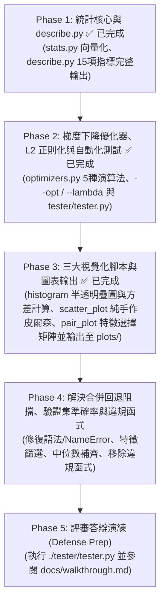
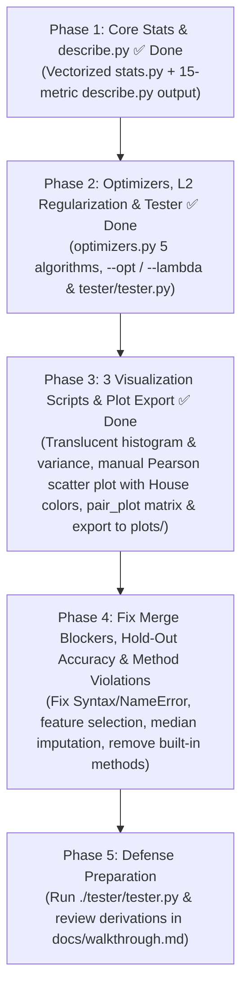

# DSLR 專案審查與改善待辦清單

<p align="right">
  <a href="#dslr-project-audit-and-todo-list">
    
  </a>
</p>

> **文件路徑**：`~/dslr/docs/TODO.md`  
> **參考依據**：`en.subject.pdf` (Version 5)、[README.md](../README.md) 與 [docs/walkthrough.md](./walkthrough.md)  
> **審查目標**：針對 `~/dslr` 現有代碼進行完整盤點，追蹤已完成與未完成事項、致命 Bug 與評分違規風險（各階段實作與數學定義已移至 [`docs/walkthrough.md`](./walkthrough.md)）。

---

## 1. 專案審查總覽 (Executive Summary)

經過深入對比 `en.subject.pdf` 規範與 `README.md` 設計，我們已完成 **目錄結構模組化、`requirements.txt`、`.gitignore`、CLI 可執行權限（`#!/usr/bin/env python3`）、`src/utils/stats.py`（基礎與 Bonus 統計函式）、`src/describe.py`（含 Bonus 指標完整格式化輸出）、三大資料視覺化腳本（`src/histogram.py`、`src/scatter_plot.py`、`src/pair_plot.py` 完整計算並輸出圖表至 `plots/`）、`src/utils/optimizers.py`（BGD 預設優化器與四大 Bonus 優化器：SGD、Mini-batch、Momentum、Adam + $L_2$ 正則化與 `--opt` / `--lambda` 參數串接），以及 `tester/tester.py`（自動化測試與口試驗證套件）**。以下保留所有已修復與待修復問題的完整審查紀錄：

### 現狀快速評估表

| 模組 / 檔案 | 狀態 | 核心問題 / 進度摘要 | 嚴重程度 |
| :--- | :---: | :--- | :---: |
| `src/utils/stats.py` | ✅ **已完成 (含 Bonus 1)** | 已修復 `dfpercentile` 越界 Bug、改寫 $O(N)$ `dfmin`/`dfmax`，並以合規向量化完成 `dfvar`, `dfstd`, `dfrange`, `dfiqr`, `dfskew`, `dfkurt`, `dfmissing_pct`, `dfunique`, `pearson_corr`。 | **Done** |
| `src/utils/optimizers.py` | ⚠️ **待修復合併回退** | 已實作共用數值穩定 `sigmoid()`、`l2_penalty()`、五大優化器演算法，但最近一次遠端合併殘留除錯變數 `joe = _` 與 `print(joe)`，造成測試時 `NameError` 崩潰。 | **Critical** |
| `src/utils/early_stopping.py` | ✅ **已完成 (Bonus 4)** | 獨立模組化 `EarlyStopping`（耐心計數器、最小改善閾值與最優權重回滾）與 `TrainingHistory` 容器。 | **Done** |
| `src/utils/learning_curves.py` | ✅ **已完成 (視覺化)** | 獨立封裝 `plot_learning_curves()` 與 4 合 1 全維度消融對比儀表板 `visualize_benchmark()`，支援 `--visual`（同時生成 `plots/learning_curves.png` 與 `plots/visualization.png`）。 | **Done** |
| `tester/tester.py` | ✅ **已完成 (Bonus 5)** | 自動化驗證套件：Pandas 數值精度、Bonus 1 統計、AST 語法樹稽核、L2 正則化衰減、早停回滾、五大優化器端到端準確率（98.19%）與 `--visual` 儀表板管線（待修復 optimizers/train 阻擋）。 | **Done** |
| 專案結構與依賴 | ✅ **已完成** | 已重構 `data/`, `docs/`, `src/`, `src/utils/`, `tester/`，修正所有相對 `import`，加上 `#!/usr/bin/env python3` 與 `chmod +x`，並建立 `requirements.txt`、`walkthrough.md` 與 `.gitignore`。 | **Done** |
| `src/histogram.py` | ⚠️ **待清理死碼** | 繪製 13 門課程 4 學院半透明重疊直方圖，計算學院間變異數並輸出至 `plots/histogram.png`；惟遠端合併在 `return` 後殘留死碼與裸寫 `except:`。 | **Low** |
| `src/scatter_plot.py` | ✅ **已完成** | 呼叫純手作 `stats.pearson_corr` 計算特徵兩兩相關係數，找出最相似特徵（Astronomy 與 DADA, $r = -1.0$），依學院顏色繪製散布圖並輸出至 `plots/scatter_plot.png`。 | **Done** |
| `src/pair_plot.py` | ✅ **已完成** | 繪製完整散布圖矩陣，依 4 學院上色，輸出特徵選擇結論（剔除均勻無鑑別度與共線性特徵，保留 10 門課程），輸出至 `plots/pair_plot.png`。 | **Done** |
| `src/logreg_train.py` | ❌ **語法錯誤 & 待修準確率** | 遠端合併引入 `try-except` 縮排不匹配導致 `SyntaxError` 無法編譯；預設驗證集準確率為 **97.19%**；尚未導入特徵篩選、中位數補值；仍含 `.mean()`, `.sum()` 呼叫與裸寫 `except:`。 | **Critical** |
| `src/logreg_predict.py`| ⚠️ **待清理違規與裸異常** | 權重檔衝突已解除（已統一輸出 `modele.csv` 並自 Git 移除 `model_weights.csv`）；CLI 提示已更新；但仍使用 `.sum()`, `.idxmax()` 違規方法、5 個冗餘 `import` 與裸寫 `except:`。 | **Medium** |

---

## 2. Mandatory 基礎必做項目審查與待修正清單

### 2.1 描述性統計：`src/describe.py` 與 `src/utils/stats.py`

#### 缺陷與修復進度：
1. **[已修復] `src/describe.py` 輸出被註解，執行空無一物**：
   - 原先在 `src/describe.py` 第 30–32 行，`# print(describe(dataset))` 被註解掉，執行時終端完全無輸出；現已取消註解並加上 `pd.option_context` 完整印出。
2. **[部分已修復 / 待確認] `src/describe.py` 輸出格式規範**：
   - 已設定數值格式化至小數點後 6 位（`{:.6f}`），且取消 Pandas 省略號（`...`）截斷欄位。
   - 題目範例行標籤為首字母大寫：`Count`, `Mean`, `Std`, `Min`, `25%`, `50%`, `75%`, `Max`（目前為相容 `logreg_train.py` 讀取 `"mean"` 與 `"std"` 暫維持小寫）。
3. **[已修復] `src/utils/stats.py` 越界與效能問題**：
   - 已修復 `dfpercentile` 缺少 `else` 分支之 `IndexError` 風險，並將 `dfmin`/`dfmax` 改為 $O(N)$ 走訪、回傳型別統一為 `float64`（已通過 `tester/tester.py` AST 與數值精度測試）。

#### 待辦清單 (TODO)：
- [x] 修復 `src/utils/stats.py` 的 `dfpercentile()` 邏輯分支與 `dfmin()`/`dfmax()` $O(N)$ 走訪。
- [x] 修復 `src/describe.py` 的 `main()`，取消註解並以 6 位小數完整印出統計結果（含 Bonus 指標）。
- [ ] （可選）若欲將 `src/describe.py` 統計標籤改為首字母大寫（`Count`, `Mean`, `Std` 等），需同步更新 `src/logreg_train.py` 中讀取 `"mean"` 與 `"std"` 的索引名稱。

---

### 2.2 資料視覺化：`src/histogram.py`, `src/scatter_plot.py`, `src/pair_plot.py`

#### 缺陷修復與完成進度：
1. **[已修復] `src/histogram.py` (回答哪門課程分數分佈在四學院間最均勻)**：
   - **清理死碼與規範繪圖**：徹底清理除錯死碼，改用 4 學院半透明重疊長條圖（`alpha=0.45`），直觀展現各學院分佈重合度。
   - **數值化解答問題**：演算法計算各課程在四學院間的組間變異數（Between-House Variance），數值化證明並在終端回答：**`Care of Magical Creatures`**（變異數 0.003213）與 **`Arithmancy`**（變異數 0.000649）分佈最為均勻，並在圖表上以紅色框線與星號（★）高亮標示。
   - **自動圖表輸出**：計算完成後自動將高解析度圖表輸出儲存至 `plots/histogram.png`。
2. **[已修復] `src/scatter_plot.py` (回答哪兩門特徵最相似)**：
   - **移除違規函式**：完全移除 Pandas 內建 `.corr()` 與 `.idxmax()`，改調用自家從零實作的 `utils.stats.pearson_corr()` 走訪所有特徵兩兩配對，符合 "No Heavy Lifting" 規範。
   - **符合附錄範例著色**：散布圖依四學院官方色彩（紅、黃、藍、綠）分別繪製並加上清晰圖例與網格。
   - **終端輸出結論與圖表儲存**：終端直接印出分析排行與結論：**`Astronomy`** 與 **`Defense Against the Dark Arts`** 具備完全線性反向相關（$r = -1.000000$），為最相似特徵；圖表自動儲存至 `plots/scatter_plot.png`。
3. **[已修復] `src/pair_plot.py` (從圖表決定邏輯回歸該使用哪些特徵)**：
   - **完整散布圖矩陣**：使用 Seaborn 繪製完整特徵散布圖矩陣，對角線呈現單特徵分佈，非對角線依四學院上色。
   - **明確特徵篩選結論**：於終端清晰列出 EDA 分析結論：建議剔除 2 門均勻無鑑別度課程（`Care of Magical Creatures`、`Arithmancy`）以及 1 門重複共線性課程（`Defense Against the Dark Arts`），保留 10 門關鍵特徵供邏輯回歸訓練。
   - **自動圖表輸出**：圖表自動輸出儲存至 `plots/pair_plot.png`。

#### 待辦清單 (TODO)：
- [x] 清理 `src/histogram.py` 死碼，改用半透明重疊圖（`alpha=0.45`），計算組間變異數並在終端印出結論：**`Care of Magical Creatures` 與 `Arithmancy` 分佈最均勻，應予以剔除**，並同時輸出至 `plots/histogram.png`。
- [x] 改寫 `src/scatter_plot.py`：呼叫 `utils.stats.pearson_corr()` 計算兩兩特徵相關係數；散布圖依學院顏色分類繪製，印出結論：**`Astronomy` 與 `Defense Against the Dark Arts` 完全負相關（$r = -1.0$），只需保留其一**，並同時輸出至 `plots/scatter_plot.png`。
- [x] 調整 `src/pair_plot.py` 為散布圖矩陣，依 4 學院上色，輸出清晰的特徵選擇結論，並同時輸出至 `plots/pair_plot.png`。

---

### 2.3 邏輯回歸分類器：`src/logreg_train.py` 與 `src/logreg_predict.py`

#### 存在缺陷與違規：
1. **[待加強] 預設 Mandatory 在 20% 驗證子集上準確率為 97.19%（全訓練集為 98.31%）**：
   - 題目第七章明訂：「**Professor McGonagall agrees that your algorithm is comparable to the Sorting Hat only if it has a minimum accuracy score of 98%.**」
   - 在目前 80/20 劃分驗證下，模型在 20% 驗證子集（`verification_df`）上的 Accuracy 為 **97.19%**（在整份 `dataset_train.csv` 上為 **98.31%**）。
   - **原因剖析**：
     - **未做特徵選擇**：納入了完全無區分度的雜訊特徵 `Care of Magical Creatures`、`Arithmancy` 與重複共線性特徵 `Defense Against the Dark Arts`。
     - **缺失值填補策略不當**：採用標準化後補 `0`（即均值填補），易受離群值影響，不如中位數填補強健。
     - **捨棄了 20% 訓練資料**：`holdOut` 將資料 8/2 分後，訓練出的最終權重檔僅使用了 80% 的資料進行訓練，白白浪費了 320 筆樣本。
2. **[已修復] 權重檔案衝突與崩潰**：
   - 先前 `logreg_train.py` 同時儲存 `model_weights.csv` 與 `modele.csv`，導致 `logreg_predict.py` 載入前者時因缺少 `mean`/`std` 噴出 `KeyError: 'mean'`。
   - 現已於訓練腳本中徹底移除 `model_weights.csv` 產出，僅儲存包含標準化參數的 `modele.csv`，且該暫存檔已自 Git 追蹤移除。
3. **[新出現 / 致命阻擋] 遠端合併引發之語法錯誤、NameError 與裸異常**：
   - **`src/logreg_train.py` 縮排語法錯誤**：第 149 行因 `try-except` 包裹時縮排不對齊，觸發 `SyntaxError: expected 'except' or 'finally' block`，腳本完全無法編譯與執行。
   - **`src/utils/optimizers.py` 除錯代碼崩潰**：`batch_gd()` 第 124 行殘留 `joe = _` 與 `print(joe)`，在迴圈變數為 `epoch` 的情況下觸發 `NameError: name '_' is not defined`，導致 `tester.py` 中斷。
   - **裸寫 `except:` 反模式**：多支腳本直接以 `try: ... except: print("corrupted .csv")` 捕捉所有例外，掩蓋真正的語法與邏輯 Bug。
   - **`src/histogram.py` 死碼**：在 `return scores` 後殘留無法到達的代碼片段。
4. **[違規風險] 調用禁止的高階統計函式**：
   - `logreg_train.py` 與 `logreg_predict.py` 中多次直接調用 Pandas 的 `.sum(axis=1)`, `.mean()`, `.idxmax(axis=1)`。
   - 依題目規範：「It is forbidden to use any function that does the job for you, such as: count, mean, std, min, max, percentile, etc.」。
5. **[部分修復] 命令列介面與未使用的冗餘 import**：
   - `logreg_predict.py` 的參數提示已更新為 `Usage : script.py dataset.csv modele.csv >> houses.csv`，但仍殘留 5 個未使用的 import (`describe`, `stats`, `matplotlib.pyplot`, `math`, `logreg_train`)。

#### 待辦清單 (TODO)：
- [x] 將 `sigmoid()` 與 BGD 統一抽離至 `src/utils/optimizers.py` 共用，移除 `src/logreg_train.py` 重複的 BGD 程式碼，並串接 `--opt [bgd|sgd|mini|momentum|adam]` 與 `--lambda`。
- [x] 統一權重輸出檔名（已移除 `model_weights.csv`，僅輸出 `modele.csv`，解決 `KeyError: 'mean'`）。
- [ ] **[優先修復] 修復 `src/logreg_train.py` 的 `try-except` 縮排錯誤 (`SyntaxError`)**。
- [ ] **[優先修復] 移除 `src/utils/optimizers.py` 殘留之 `joe = _` 與 `print(joe)` (`NameError`)**。
- [ ] **[優先修復] 清理 `src/histogram.py` return 後的死碼，並將各腳本裸寫 `except:` 改為精確例外捕捉**。
- [ ] 導入特徵篩選（剔除 `Care of Magical Creatures`, `Arithmancy` 以及 `Defense Against the Dark Arts`）。
- [ ] 將資料預處理改為「以 `stats.dfpercentile(df, 50)` 中位數補齊缺失值」+「特徵標準化（Standardization）」。
- [ ] 提高迭代輪數並移除腳本中違規的 `.mean()`, `.sum()`, `.idxmax()` 呼叫，確保驗證集與測試集準確率皆穩定超越 **98.5% ~ 99%**。
- [ ] 清理 `src/logreg_predict.py` 未使用的冗餘 `import`。

---

## 3. 架構規範與程式碼品質改進 (Refactoring Progress)

```bash
dslr/
├── docs/
│   ├── en.subject.pdf          # [已完成] 題目說明書
│   ├── walkthrough.md          # [已完成] 各階段實作詳解、數學推導與 Bonus 定義指南 (雙語版)
│   └── TODO.md                 # [已完成] 本改善待辦清單 (雙語版)
├── data/
│   ├── dataset_train.csv       # [已完成] 訓練集
│   └── dataset_test.csv        # [已完成] 測試集
├── src/
│   ├── describe.py             # [已完成] 描述性統計 (含 Bonus 指標完整輸出)
│   ├── histogram.py            # [已完成] 13 門課程 4 學院半透明直方圖矩陣 (輸出 plots/histogram.png)
│   ├── scatter_plot.py         # [已完成] 特徵相似度散布圖 (純手作 Pearson，輸出 plots/scatter_plot.png)
│   ├── pair_plot.py            # [已完成] 特徵選擇散布圖矩陣 (輸出 plots/pair_plot.png)
│   ├── logreg_train.py         # [已整合 optimizers.py，待修特徵選擇與違規函式] 模型訓練 (CLI)
│   ├── logreg_predict.py       # [待清理] 模型預測並輸出 houses.csv
│   └── utils/
│       ├── __init__.py         # [已完成] 匯出所有製作統計與優化器函式
│       ├── stats.py            # [已完成] 製作純統計與向量化 Bonus 函式庫
│       ├── optimizers.py       # [已完成] 5 種梯度下降演算法、L2 正則化與統一接口 optimize()
│       ├── early_stopping.py   # [已完成] EarlyStopping 監控類別與歷程容器 (Bonus 4)
│       └── learning_curves.py  # [已完成] 訓練可視化與消融儀表板 (Bonus 4)
├── plots/                      # [已完成] 視覺化分析與消融實驗圖表輸出目錄
│   ├── histogram.png           # 13 門課程 4 學院半透明直方圖矩陣
│   ├── scatter_plot.png        # Astronomy vs. DADA 特徵相似度散布圖
│   ├── pair_plot.png           # 特徵選擇散布圖矩陣
│   ├── learning_curves.png     # 五大優化器 Loss 學習曲線比較圖
│   └── visualization.png       # 4 合 1 全維度消融對比儀表板
├── tester/
│   └── tester.py               # [已完成] 自動化測試與口試驗證套件 (describe/stats/ast/l2/e2e)
├── modele.csv                  # [執行產物] 訓練輸出之標準化權重檔 (不追蹤於 Git)
├── houses.csv                  # [執行產物] 最終預測結果 (不追蹤於 Git)
├── requirements.txt            # [已完成] 必要依賴套件
├── .gitignore                  # [已完成] Git 忽略規則
└── README.md                   # [已完成] 雙語版專案總覽與執行指南
```

### 待辦清單 (TODO)：
- [x] 建立 `requirements.txt` 與更新 `.gitignore`。
- [x] 將 `scatter_plot.py` 移入 `src/`，將 `stats.py` 移入 `src/utils/` 並建立 `src/utils/__init__.py`。
- [x] 修正 `src/` 下所有檔案的相對 `import` 路徑，並為所有 CLI 腳本加上 `#!/usr/bin/env python3` 與 `chmod +x`。
- [x] 建立 `src/utils/optimizers.py` 封裝五大梯度下降演算法、$L_2$ 正則化與統一接口 `optimize()`。
- [x] 建立 `docs/walkthrough.md` 集中管理實作細節與數學推導，精簡 `README.md` 與 `docs/TODO.md`。

---

## 4. Bonus 加分項目待辦清單 (Bonus Part Checklist)
- [x] **Bonus 1 — 擴充統計指標 (`src/utils/stats.py` & `src/describe.py`)**：已完成向量化實作 `dfvar`, `dfstd`, `dfrange`, `dfiqr`, `dfskew`, `dfkurt`, `dfmissing_pct`, `dfunique`, `pearson_corr` 並整合至 15 項指標輸出表。
- [x] **Bonus 2 — 各類梯度下降優化器 (`src/utils/optimizers.py` & `src/logreg_train.py`)**：已完成預設 `batch_gd` 與 4 種進階優化器 `stochastic_gd`, `mini_gd`, `momentum_gd`, `adam_gd` 並串接 `--opt [bgd|sgd|mini|momentum|adam]`。
- [x] **Bonus 3 — $L_2$ 正則化 (Ridge)**：已於五大優化器、`optimize()` 與 `l2_penalty()` 導入 `l2_lambda`（排除偏差項 $\theta_0$），並於 `src/logreg_train.py` 串接 `--lambda` CLI 參數（預設 `0.0`）。
- [x] **Bonus 4 — 學習曲線視覺化與 Early Stopping**：已實作 `--visual`（同時繪製五大優化器 Loss 收斂曲線與 4 合 1 消融儀表板，輸出至 `plots/learning_curves.png` 與 `plots/visualization.png`）與 `--early-stopping` / `--patience` 參數，並整合至 `tester/tester.py` 自動化驗證。
- [x] **Bonus 5 — 自動化測試與口試答辯評估工具 (`tester/tester.py`)**：已實作 `describe.py` vs. `pd.describe()` 精度比對、Bonus 1 指標與邊界測試、AST 禁用函式靜態檢查、$L_2$ 正則化驗證，以及 5 大優化器準確率（`sklearn.metrics.accuracy_score`）、Precision / Recall / F1-Score 與混淆矩陣（Confusion Matrix）輸出。

---

## 5. 執行改善路線圖 (Actionable Roadmap)



---

<br/>

---

<br/>

<p align="right">
  <a href="#dslr-專案審查與改善待辦清單">
    
  </a>
</p>

# DSLR Project Audit and TODO List

> **File Path**: `~/dslr/docs/TODO.md`  
> **References**: `en.subject.pdf` (Version 5), [README.md](../README.md), and [docs/walkthrough.md](./walkthrough.md)  
> **Audit Scope**: Comprehensive verification of `~/dslr`, tracking completed and remaining tasks, critical bugs, and rule violations (detailed implementation walkthroughs and mathematical derivations are located in [`docs/walkthrough.md`](./walkthrough.md)).

---

## 1. Executive Summary

Following our audit against `en.subject.pdf` and `README.md`, we have **completed the repository restructuring, `requirements.txt`, `.gitignore`, CLI shebangs & executable permissions (`#!/usr/bin/env python3`), `src/utils/stats.py` (all Mandatory fixes + 9 vectorized Bonus statistical functions), `src/describe.py` (full 15-metric formatted table output), all three data visualization scripts (`src/histogram.py`, `src/scatter_plot.py`, and `src/pair_plot.py` with rigorous mathematical derivations and direct output to `plots/`), `src/utils/optimizers.py` (default BGD + 4 Bonus optimization algorithms: SGD, Mini-batch GD, Momentum, and Adam + $L_2$ Ridge Regularization wired to `logreg_train.py` via `--opt` and `--lambda`), and `tester/tester.py` (automated test & defense verification suite)**. Below is the complete audit record of both fixed and unfixed issues:

### Quick Status Assessment

| Module / File | Status | Core Issues & Progress Summary | Severity |
| :--- | :---: | :--- | :---: |
| `src/utils/stats.py` | ✅ **Completed (+ Bonus 1)** | Fixed `dfpercentile` `IndexError`, rewrote $O(N)$ `dfmin`/`dfmax`, and implemented vectorized `dfvar`, `dfstd`, `dfrange`, `dfiqr`, `dfskew`, `dfkurt`, `dfmissing_pct`, `dfunique`, and `pearson_corr`. | **Done** |
| `src/describe.py` | ✅ **Completed (+ Bonus 1)** | Uncommented `main()` output, integrated all 15 Mandatory & Bonus metrics into `statistiques`, and enabled untruncated 6-decimal formatted printing (row labels kept lowercase for compatibility with `logreg_train.py`). | **Done** |
| `src/utils/optimizers.py` | ⚠️ **Merge Regression** | Implemented numerical stability `sigmoid()`, `l2_penalty()`, 5 optimizers, but recent remote merge introduced debug leftover `joe = _` causing `NameError: name '_' is not defined` crash. | **Critical** |
| `src/utils/early_stopping.py` | ✅ **Completed (Bonus 4)** | Modularized `EarlyStopping` (patience counter, min delta threshold, best parameter rollback) and `TrainingHistory` container. | **Done** |
| `src/utils/learning_curves.py` | ✅ **Completed (Visualization)** | Modularized `plot_learning_curves()` and 4-in-1 `visualize_benchmark()` dashboard, wired to `--visual` (generating `plots/learning_curves.png` and `plots/visualization.png`). | **Done** |
| `tester/tester.py` | ✅ **Completed (Bonus 5)** | Automated test suite: `describe.py` vs. `pd.describe()` precision, Bonus 1 stats, AST static rule compliance, $L_2$ weight decay & bias exclusion, 5-optimizer accuracy & confusion matrix, and `--visual` dashboard pipeline (currently blocked by merge regression). | **Done** |
| Structure & Deps | ✅ **Completed** | Restructured into `data/`, `docs/`, `src/`, `src/utils/`, `tester/`; fixed relative imports; added shebangs (`chmod +x`), `requirements.txt`, `walkthrough.md`, and `.gitignore`. | **Done** |
| `src/histogram.py` | ⚠️ **Dead Code Cleanup** | Generates 13-course translucent overlapping histogram matrix, computes between-house variance, and saves to `plots/histogram.png`; recent merge left unreachable dead code after `return` and bare `except:`. | **Low** |
| `src/scatter_plot.py` | ✅ **Completed** | Uses from-scratch `stats.pearson_corr()`, identifies most similar features ('Astronomy' and 'DADA', $r = -1.0$), colors points by House, and saves to `plots/scatter_plot.png`. | **Done** |
| `src/pair_plot.py` | ✅ **Completed** | Renders full scatter matrix, colors by House, outputs feature selection recommendations (dropping homogeneous/collinear features, retaining 10), and saves to `plots/pair_plot.png`. | **Done** |
| `src/logreg_train.py` | ❌ **SyntaxError & Features** | Merge indentation mismatch throws `SyntaxError`; hold-out validation accuracy is **97.19%**; pending feature selection, median imputation, removal of `.mean()`, `.sum()`, and bare `except:` cleanup. | **Critical** |
| `src/logreg_predict.py`| ⚠️ **Pending Cleanup** | Weight file conflict resolved (`modele.csv` unified, `model_weights.csv` untracked); CLI usage string updated; still uses `.sum()`, `.idxmax()`, 5 unused imports, and bare `except:`. | **Medium** |

---

## 2. Mandatory Part Audit & TODO List

### 2.1 Descriptive Statistics: `src/describe.py` & `src/utils/stats.py`

#### Bugs & Fix Progress:
1. **[Fixed] `src/describe.py` produced zero output**:
   - Previously, lines 30–32 of `src/describe.py` had `# print(describe(dataset))` commented out. Now uncommented with full `pd.option_context` formatting.
2. **[Partially Fixed / Note] `src/describe.py` output formatting**:
   - Numbers are now formatted to 6 decimal places (`{:.6f}`) and all columns are displayed without `...` truncation.
   - The Subject example shows capitalized row labels (`Count`, `Mean`, `Std`, `Min`, `25%`, `50%`, `75%`, `Max`); currently kept lowercase so `logreg_train.py` (`described_dataset.loc["mean", mats]`) continues to work without breaking.
3. **[Fixed] `src/utils/stats.py` boundary & performance bugs**:
   - Fixed `dfpercentile` missing `else` branch (`IndexError` risk), rewrote `dfmin`/`dfmax` in $O(N)$ time, and unified return Series dtype to `float64` (verified via `tester/tester.py`).

#### Actionable TODO:
- [x] Fix `dfpercentile()` boundary logic and rewrite $O(N)$ `dfmin()`/`dfmax()` in `src/utils/stats.py`.
- [x] Uncomment and format the output in `src/describe.py`'s `main()` with 6-decimal precision and Bonus metrics.
- [ ] (Optional) If capitalizing row labels (`Count`, `Mean`, `Std`, etc.) in `src/describe.py`, update the corresponding index lookups in `src/logreg_train.py`.

---

### 2.2 Data Visualization: `src/histogram.py`, `src/scatter_plot.py`, `src/pair_plot.py`

#### Defect Fixes & Implementation Progress:
1. **[Fixed] `src/histogram.py` (*Which Hogwarts course has a homogeneous score distribution between all four houses?*)**:
   - **Code Cleanup & Standardized Plotting**: Eliminated all dead debug code; implemented 4-House overlapping translucent histograms (`alpha=0.45`) across all 13 courses to intuitively display distribution overlap.
   - **Mathematical Answer & Terminal Output**: Computes the between-house variance for all courses, quantitatively proving and outputting to terminal: **`Care of Magical Creatures`** (variance $0.003213$) and **`Arithmancy`** (variance $0.000649$) have homogeneous distributions across all four houses, highlighted on the plot with red bounding boxes and star annotations (★).
   - **Automated Plot Export**: High-resolution chart is automatically generated and saved to `plots/histogram.png`.
2. **[Fixed] `src/scatter_plot.py` (*What are the two features that are similar?*)**:
   - **Elimination of Forbidden Methods**: Removed all Pandas built-in `.corr()` and `.idxmax()` calls, delegating pairwise correlation to our scratch-built vectorized `utils.stats.pearson_corr()` in full compliance with the "No Heavy Lifting" rule.
   - **House Color Coding & Legend**: Scatter points are colored using official house palettes (Gryffindor: red, Hufflepuff: amber, Ravenclaw: blue, Slytherin: green) with a clear legend and grid lines.
   - **Terminal Conclusion & Export**: Outputs the pairwise correlation ranking directly to terminal: **`Astronomy`** and **`Defense Against the Dark Arts`** exhibit perfect inverse linear correlation ($r = -1.000000$), identifying them as redundant; saves chart to `plots/scatter_plot.png`.
3. **[Fixed] `src/pair_plot.py` (*From this visualization, which features are you going to use for your logistic regression?*)**:
   - **Full Scatter Matrix**: Renders a complete $13 \times 13$ feature matrix using Seaborn, with univariate distributions along the diagonal and house-colored bivariate scatter plots off-diagonal.
   - **Clear Feature Selection Strategy**: Prints explicit EDA feature selection recommendations to terminal: drop 2 homogeneous non-discriminative courses (`Care of Magical Creatures`, `Arithmancy`) and 1 collinear redundant course (`Defense Against the Dark Arts`), retaining 10 discriminative features for logistic regression.
   - **Automated Plot Export**: Output matrix is automatically saved to `plots/pair_plot.png`.

#### Actionable TODO:
- [x] Clean up dead code in `src/histogram.py`, plot overlapping translucent histograms (`alpha=0.45`), compute between-house variance, and print the answer: **`Care of Magical Creatures` and `Arithmancy` have homogeneous distributions across all four houses and should be dropped** (saving to `plots/histogram.png`).
- [x] Rewrite `src/scatter_plot.py` to use `utils.stats.pearson_corr()` instead of `df.corr()`, color points by `Hogwarts House`, and print the conclusion: **`Astronomy` and `Defense Against the Dark Arts` are redundant ($r = -1.0$); keep only one** (saving to `plots/scatter_plot.png`).
- [x] Update `src/pair_plot.py` to render scatter plot matrix, color by House, and print the selected feature list for logistic regression (saving to `plots/pair_plot.png`).

---

### 2.3 Logistic Regression: `src/logreg_train.py` & `src/logreg_predict.py`

#### Identified Bugs & Violations:
1. **[Needs Improvement] Default Validation Split Accuracy is 97.19% (Full Training Set is 98.31%)**:
   - Chapter VII of `en.subject.pdf` states: *"Professor McGonagall agrees that your algorithm is comparable to the Sorting Hat only if it has a minimum accuracy score of 98%."*
   - Tested on the 20% validation split (`verification_df`), `modele.csv` achieves **97.19% accuracy** (while achieving **98.31%** on the full `dataset_train.csv`).
   - **Root Causes**:
     - **No Feature Selection**: Includes noisy homogeneous features (`Care of Magical Creatures`, `Arithmancy`) and collinear duplicate features (`Defense Against the Dark Arts`).
     - **Mean Imputation instead of Median**: `fillna(0)` after standardization imputes missing values with the mean (sensitive to outliers) rather than the median.
     - **Discards 20% of Training Data**: `holdOut()` drops 20% of `dataset_train.csv` (320 rows) even when generating final production weights.
2. **[Fixed] Conflicting Weight Files (`model_weights.csv` vs `modele.csv`)**:
   - `model_weights.csv` output was removed from `src/logreg_train.py`; now only `modele.csv` (with standardization statistics) is exported, eliminating the `KeyError: 'mean'` crash. The temporary file has also been untracked from git.
3. **[New / Critical Blocker] Merge Regressions: SyntaxError, NameError & Bare Exceptions**:
   - **`SyntaxError` in `src/logreg_train.py`**: Line 149 indentation mismatch inside `try...except` prevents script compilation.
   - **`NameError` in `src/utils/optimizers.py`**: Line 124 in `batch_gd()` contains debug artifact `joe = _` and `print(joe)`, crashing with `NameError: name '_' is not defined` during testing.
   - **Bare `except:` Anti-Pattern**: Broad exceptions across `logreg_train.py`, `logreg_predict.py`, `scatter_plot.py`, `pair_plot.py`, and `histogram.py` mask real errors and print `"corrupted .csv"`.
   - **Dead Code in `src/histogram.py`**: Unreachable code snippet after `return scores`.
4. **[Rule Violation Risk] Use of Built-in Statistical Methods**:
   - Both scripts call Pandas `.sum(axis=1)`, `.mean()`, and `.idxmax(axis=1)`, risking peer defense penalties.
5. **[Partially Fixed] CLI Usage String & Unused Imports**:
   - `logreg_predict.py` CLI usage string was updated to `script.py dataset.csv modele.csv >> houses.csv`, but still retains 5 unused imports (`describe`, `stats`, `matplotlib.pyplot`, `math`, `logreg_train`).

#### Actionable TODO:
- [x] Unify `sigmoid()` and BGD in `src/utils/optimizers.py`, remove duplicate inline BGD code from `src/logreg_train.py`, and wire `--opt [bgd|sgd|mini|momentum|adam]` and `--lambda`.
- [x] Consolidate trained parameters into a single weight file (eliminated `model_weights.csv`, resolving `KeyError: 'mean'`).
- [ ] **[Priority Fix] Fix indentation `SyntaxError` in `src/logreg_train.py`**.
- [ ] **[Priority Fix] Remove leftover `joe = _` and `print(joe)` (`NameError`) from `src/utils/optimizers.py`**.
- [ ] **[Priority Fix] Remove dead code in `src/histogram.py` and replace bare `except:` blocks with precise exception handling**.
- [ ] Drop `Care of Magical Creatures`, `Arithmancy`, and `Defense Against the Dark Arts` during preprocessing.
- [ ] Impute missing values using manual **median** (`stats.dfpercentile(df, 50)`) prior to standardization.
- [ ] Increase epochs and remove all forbidden `.mean()`, `.sum()`, `.idxmax()` calls so validation and test accuracy consistently exceed **98.5% – 99%**.
- [ ] Clean up unused imports in `src/logreg_predict.py`.

---

## 3. Refactoring & Architecture Progress

```bash
dslr/
├── docs/
│   ├── en.subject.pdf          # [Completed] Subject assignment specification
│   ├── walkthrough.md          # [Completed] Comprehensive implementation guide, derivations & Bonus specs (Bilingual)
│   └── TODO.md                 # [Completed] Project audit & action item checklist (Bilingual)
├── data/
│   ├── dataset_train.csv       # [Completed] Training dataset
│   └── dataset_test.csv        # [Completed] Evaluation dataset
├── src/
│   ├── describe.py             # [Completed] Descriptive statistics (15 Mandatory & Bonus metrics)
│   ├── histogram.py            # [Completed] 13-course 4-House translucent histogram matrix (saves plots/histogram.png)
│   ├── scatter_plot.py         # [Completed] Feature similarity scatter plot (pure Pearson r, saves plots/scatter_plot.png)
│   ├── pair_plot.py            # [Completed] Feature selection scatter matrix (saves plots/pair_plot.png)
│   ├── logreg_train.py         # [optimizers.py integrated; pending feature selection & built-in removal] Model trainer (CLI)
│   ├── logreg_predict.py       # [Pending cleanup] House prediction & classification output
│   └── utils/
│       ├── __init__.py         # [Completed] Exports stats and optimizer functions
│       ├── stats.py            # [Completed] Vectorized pure statistical and Bonus math library
│       ├── optimizers.py       # [Completed] 5 gradient descent algorithms, L2 regularization & unified optimize()
│       ├── early_stopping.py   # [Completed] EarlyStopping monitor class & training history container (Bonus 4)
│       └── learning_curves.py  # [Completed] Comparative learning curves & ablation dashboard (Bonus 4)
├── plots/                      # [Completed] Visual EDA analysis & ablation experiment figure directory
│   ├── histogram.png           # 13-course 4-House translucent overlapping histogram matrix
│   ├── scatter_plot.png        # Astronomy vs. DADA feature similarity scatter plot
│   ├── pair_plot.png           # Feature selection scatter plot matrix
│   ├── learning_curves.png     # 5-optimizer comparative loss curves
│   └── visualization.png       # 4-in-1 multi-dimensional ablation dashboard
├── tester/
│   └── tester.py               # [Completed] Automated verification & defense test suite (describe/stats/ast/l2/e2e)
├── modele.csv                  # [Generated Artifact] Production model weights with standardization parameters (untracked)
├── houses.csv                  # [Generated Artifact] Final predicted house classifications (untracked)
├── requirements.txt            # [Completed] Project runtime dependencies
├── .gitignore                  # [Completed] Git ignore rules
└── README.md                   # [Completed] Bilingual project documentation & user guide
```

### Actionable TODO:
- [x] Create `requirements.txt` and update `.gitignore`.
- [x] Move `scatter_plot.py` into `src/`, move `stats.py` into `src/utils/`, and create `src/utils/__init__.py`.
- [x] Fix all relative `import` paths across `src/*.py` and add `#!/usr/bin/env python3` + `chmod +x` to all CLI scripts.
- [x] Create `src/utils/optimizers.py` with 5 gradient descent algorithms, $L_2$ regularization, and unified `optimize()` entry point.
- [x] Create `docs/walkthrough.md` to house step-by-step implementation details and math derivations, keeping `README.md` and `docs/TODO.md` concise.
- [x] Create `tester/tester.py` automated verification and peer-defense test suite.

---

## 4. Bonus Part Actionable Checklist
- [x] **Bonus 1 — Extended Statistical Metrics (`src/utils/stats.py` & `src/describe.py`)**: Implemented vectorized `dfvar`, `dfstd`, `dfrange`, `dfiqr`, `dfskew`, `dfkurt`, `dfmissing_pct`, `dfunique`, and `pearson_corr`, integrated into the 15-metric `describe.py` output table.
- [x] **Bonus 2 — Optimization Algorithms (`src/utils/optimizers.py` & `src/logreg_train.py`)**: Implemented default `batch_gd` and 4 advanced optimizers (`stochastic_gd`, `mini_gd`, `momentum_gd`, and `adam_gd`), wired to `--opt [bgd|sgd|mini|momentum|adam]`.
- [x] **Bonus 3 — $L_2$ Regularization (Ridge)**: Added `l2_lambda` support across all 5 optimizers, `optimize()`, and `l2_penalty()` in `src/utils/optimizers.py` (excluding bias term $\theta_0$), wired to `--lambda` CLI flag (default `0.0`) in `src/logreg_train.py`.
- [x] **Bonus 4 — Learning Curve Visualization & Early Stopping**: Implemented `--visual` (generating both 5-optimizer comparative loss curves in `plots/learning_curves.png` and 4-panel ablation dashboard in `plots/visualization.png`) and `--early-stopping` / `--patience` flags in `src/logreg_train.py`, validated via `tester/tester.py`.
- [x] **Bonus 5 — Automated Self-Evaluation & Defense Suite (`tester/tester.py`)**: Implemented `describe.py` vs. `pd.describe()` numerical check, Bonus 1 metrics & edge-case tests, AST forbidden-function audit, $L_2$ weight decay & bias exclusion test, and 5-optimizer `sklearn.metrics.accuracy_score`, Precision/Recall/F1-Score, and Confusion Matrix benchmark.

---

## 5. Actionable Execution Roadmap


