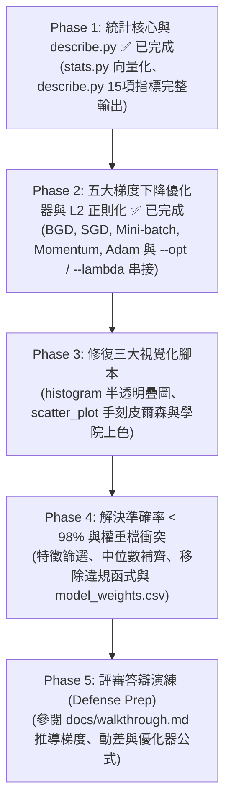
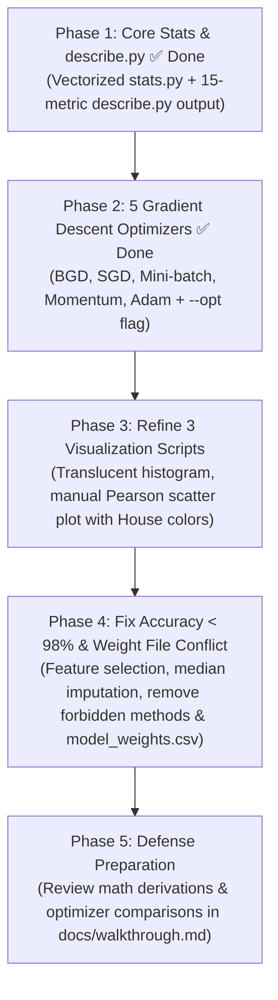

# DSLR 專案審查與改善待辦清單

<p align="right">
  <a href="#dslr-project-audit-and-todo-list">
    
  </a>
</p>

> **文件路徑**：`~/dslr/docs/TODO.md`  
> **參考依據**：`en.subject.pdf` (Version 5)、[README.md](../README.md) 與 [docs/walkthrough.md](./walkthrough.md)  
> **審查目標**：針對 `~/dslr` 現有代碼進行完整盤點，追蹤已完成與未完成事項、致命 Bug 與評分違規風險（各階段實作與數學定義已移至 [`docs/walkthrough.md`](./walkthrough.md)）。

---

## 1. 專案審查總覽 (Executive Summary)

經過深入對比 `en.subject.pdf` 規範與 `README.md` 設計，我們已完成 **目錄結構模組化、`requirements.txt`、`.gitignore`、`src/utils/stats.py`（基礎與 Bonus 統計函式）、`src/describe.py`（含 Bonus 指標完整格式化輸出），以及 `src/utils/optimizers.py`（五大梯度下降優化器：BGD、SGD、Mini-batch、Momentum、Adam 與 `--opt` 參數串接）**。以下保留所有已修復與待修復問題的完整審查紀錄：

### 現狀快速評估表

| 模組 / 檔案 | 狀態 | 核心問題 / 進度摘要 | 嚴重程度 |
| :--- | :---: | :--- | :---: |
| `src/utils/stats.py` | ✅ **已完成 (含 Bonus)** | 已修復 `dfpercentile` 越界 Bug、改寫 $O(N)$ `dfmin`/`dfmax`，並以合規向量化完成 `dfvar`, `dfstd`, `dfrange`, `dfiqr`, `dfskew`, `dfkurt`, `dfmissing_pct`, `dfunique`, `pearson_corr`。 | **Done** |
| `src/describe.py` | ✅ **已完成 (含 Bonus)** | 已修復 `main()` 註解無輸出問題、整合全部 15 項基礎與 Bonus 統計指標至 `statistiques`，並啟用無截斷 6 位小數格式化輸出（註：行標籤目前維持小寫以相容 `logreg_train.py`）。 | **Done** |
| `src/utils/optimizers.py` | ✅ **已完成 (Bonus)** | 已實作共用 `sigmoid()` 及其他優化器：`batch_gd`, `stochastic_gd`, `mbgd_gd`, `momentum_gd`, `adam_gd` 與統一接口 `optimize()`，並於 `logreg_train.py` 支援 `--opt` 切換。 | **Done** |
| 專案結構與依賴 | ✅ **已完成** | 已重構 `data/`, `docs/`, `src/`, `src/utils/`，修正所有相對 `import`，並建立 `requirements.txt` 與 `.gitignore`。 | **Done** |
| `src/histogram.py` | ⚠️ 待修整 | 殘留大量註解死碼；未以半透明疊加繪圖（可讀性差）；未於終端或圖表標題明確回答問題。 | **Medium** |
| `src/scatter_plot.py` | ⚠️ 違規風險 | 仍調用 Pandas 高階 `.corr()` 與 `.idxmax()`（應改用 `stats.pearson_corr`）；未依學院上色；未印出結論。 | **High** |
| `src/pair_plot.py` | ⚠️ 未落實反饋 | 繪圖僅繪製下三角；最關鍵的是**未將圖表觀察成果應用於特徵篩選**（後續訓練仍無腦全取）。 | **Medium** |
| `src/logreg_train.py` | ❌ 準確率未達標 & 違規 | 預設 Mandatory 驗證準確率僅 **97.19%**（未達 98% 門檻）；無特徵篩選；固定 100 輪未收斂；大量使用 `.mean()`, `.sum()`, `.max()` 等違規方法。 | **Critical** |
| `src/logreg_predict.py`| ❌ 致命檔案衝突 | 訓練腳本同時產出兩份權重檔，若載入 `model_weights.csv` 會因缺少 `mean`/`std` 噴 `KeyError` 崩潰；使用 `.sum()`, `.idxmax()` 違規方法；CLI 提示錯誤。 | **Critical** |

---

## 2. Mandatory 基礎必做項目審查與待修正清單

### 2.1 描述性統計：`src/describe.py` 與 `src/utils/stats.py`

#### 缺陷與修復進度：
1. **[已修復] `src/describe.py` 輸出被註解，執行空無一物**：
   - 原先在 `src/describe.py` 第 30–32 行，`# print(describe(dataset))` 被註解掉，執行時終端完全無輸出；現已取消註解並加上 `pd.option_context` 完整印出。
2. **[部分已修復 / 待確認] `src/describe.py` 輸出格式規範**：
   - 已設定數值格式化至小數點後 6 位（`{:.6f}`），且取消 Pandas 省略號（`...`）截斷欄位。
   - 題目範例行標籤為首字母大寫：`Count`, `Mean`, `Std`, `Min`, `25%`, `50%`, `75%`, `Max`（目前為相容 `logreg_train.py` 讀取 `"mean"` 與 `"std"` 暫維持小寫）。
3. **[已修復] `src/utils/stats.py` 越界與效能問題**：
   - 已修復 `dfpercentile` 缺少 `else` 分支之 `IndexError` 風險，並將 `dfmin`/`dfmax` 改為 $O(N)$ 走訪、回傳型別統一為 `float64`。

#### 待辦清單 (TODO)：
- [x] 修復 `src/utils/stats.py` 的 `dfpercentile()` 邏輯分支與 `dfmin()`/`dfmax()` $O(N)$ 走訪。
- [x] 修復 `src/describe.py` 的 `main()`，取消註解並以 6 位小數完整印出統計結果（含 Bonus 指標）。
- [ ] （可選）若欲將 `src/describe.py` 統計標籤改為首字母大寫（`Count`, `Mean`, `Std` 等），需同步更新 `src/logreg_train.py` 中讀取 `"mean"` 與 `"std"` 的索引名稱。

---

### 2.2 資料視覺化：`src/histogram.py`, `src/scatter_plot.py`, `src/pair_plot.py`

#### 存在缺陷與違規：
1. **`src/histogram.py` (回答哪門課程分數分佈在四學院間最均勻)**：
   - **程式碼混亂**：包含大量註解掉的除錯程式碼，第 37–42 行無意義計算 `Muggle Studies` 後立刻在第 85 行被覆蓋。
   - **圖表呈現不佳**：使用 `ax.hist(notes, bins=20)` 會繪製出 4 根並排的細條，而非附錄 VIII.2 範例所示的**半透明重疊長條圖**（`alpha=0.5`），難以直觀看清重合度。
   - **未明確回答問題**：腳本僅一口氣畫出 13 張子圖，沒有標註或印出核心答案：`Care of Magical Creatures`（四學院常態分佈幾近完全重合）與 `Arithmancy`。
2. **`src/scatter_plot.py` (回答哪兩門特徵最相似)**：
   - **[高風險違規]**：第 19 行調用了 Pandas 內建的高階函式 `correl = matieres.corr(method="pearson").abs()` 以及第 26 行的 `.idxmax()`。在 42 評分標準中，直接調用現成相關係數函式可能被質疑違背 "No Heavy Lifting" 原則（應改用 `src/utils/stats.py` 中的 `pearson_corr()`）。
   - **圖表不符範例**：僅單純呼叫 `dataset.plot.scatter(x=mat1, y=mat2)`，所有資料點均為同一種藍色，未像附錄 VIII.2 依四學院著色（紅、黃、藍、綠）並標示圖例。
   - **未印出結論**：未在終端輸出最相似特徵為 `Astronomy` 與 `Defense Against the Dark Arts`（二者相關係數高達 $-1.0$，完全線性反向相關）。
3. **`src/pair_plot.py` (從圖表決定邏輯回歸該使用哪些特徵)**：
   - 使用 `corner=True` 僅畫出下半部，且對角線為 KDE 曲線，與附錄範例的完整矩陣直方圖略有出入。
   - **致命脫節：EDA 結論未被後續模型採用**！題目設計視覺化的核心目的在於「特徵選擇（Feature Selection）」，然而 `logreg_train.py` 卻直接無腦將 13 門課程全部納入訓練！

#### 待辦清單 (TODO)：
- [ ] 清理 `src/histogram.py` 死碼，改用半透明重疊圖（`alpha=0.4`），並在終端印出結論：**`Care of Magical Creatures` 與 `Arithmancy` 分佈最均勻，應予以剔除**。
- [ ] 改寫 `src/scatter_plot.py`：呼叫 `utils.stats.pearson_corr()` 計算兩兩特徵相關係數；散布圖依學院顏色分類繪製，並印出結論：**`Astronomy` 與 `Defense Against the Dark Arts` 完全負相關（$r = -1.0$），只需保留其一**。
- [ ] 調整 `src/pair_plot.py` 為完整散布圖矩陣，並輸出清晰的特徵選擇結論。

---

### 2.3 邏輯回歸分類器：`src/logreg_train.py` 與 `src/logreg_predict.py`

#### 存在缺陷與違規：
1. **[評分不及格] 預設 Mandatory 驗證準確率未達 98% 門檻（目前僅 97.19%）**：
   - 題目第七章明訂：「**Professor McGonagall agrees that your algorithm is comparable to the Sorting Hat only if it has a minimum accuracy score of 98%.**」
   - 在目前 80/20 劃分驗證下，模型在驗證子集上的 Accuracy 僅有 **97.19%**（低於 98% 標準）。
   - **原因剖析**：
     - **迭代輪數過低未收斂**：第 127 行寫死 `for i in range(100):`，學習率 `0.07` 跑 100 輪根本未收斂（`gradient_max < 1e-4` 從未觸發）。
     - **捨棄了 20% 訓練資料**：`holdOut` 將資料 8/2 分後，訓練出的最終權重檔僅使用了 80% 的資料進行訓練，白白浪費了 320 筆樣本。
     - **未做特徵選擇**：納入了完全無區分度的雜訊特徵 `Care of Magical Creatures`、`Arithmancy` 與重複共線性特徵 `Defense Against the Dark Arts`。
     - **缺失值填補策略不當**：採用標準化後補 `0`（即均值填補），易受離群值影響，不如中位數填補強健。
2. **[致命 Bug] 權重檔案衝突與崩潰**：
   - `logreg_train.py` 同時儲存了兩個檔案：`model_weights.csv`（僅含權重與 bias）與 `modele.csv`（含權重、bias 與 `mean`、`std`）。
   - 然而 `logreg_predict.py` 第 26 行強制讀取 `weights.loc[mats, "mean"]` 與 `std`。
   - 若使用者或評審執行 `python3 src/logreg_predict.py data/dataset_test.csv model_weights.csv`，會立即噴出 `KeyError: 'mean'` 異常崩潰！
3. **[違規風險] 調用禁止的高階統計函式**：
   - `logreg_train.py` 與 `logreg_predict.py` 中多次直接調用 Pandas 的 `.sum(axis=1)`, `.max()`, `.mean()`, `.idxmax(axis=1)`。
   - 依題目規範：「It is forbidden to use any function that does the job for you, such as: count, mean, std, min, max, percentile, etc.」。
4. **[命令列介面與提示錯誤]**：
   - `logreg_predict.py` 檢查參數時若 `len(sys.argv) < 3`，報錯訊息卻印出 `Usage : python script.py fichier.csv`（少提示了一個權重檔參數），且含有 5 個未使用的冗餘 `import`。

#### 待辦清單 (TODO)：
- [x] 將 `sigmoid()` 統一抽離至 `src/utils/optimizers.py` 共用，並在 `src/logreg_train.py` 串接 `--opt [bgd|sgd|mbgd|momentum|adam]`。
- [ ] 統一權重輸出檔名（移除不含 `mean`/`std` 的 `model_weights.csv`，避免誤傳給 `logreg_predict.py` 導致 `KeyError: 'mean'`）。
- [ ] 導入特徵篩選（剔除 `Care of Magical Creatures`, `Arithmancy` 以及 `Defense Against the Dark Arts`）。
- [ ] 將資料預處理改為「以 `stats.dfpercentile(df, 50)` 中位數補齊缺失值」+「Z-score 標準化」。
- [ ] 提高迭代輪數並移除腳本中違規的 `.mean()`, `.sum()`, `.max()`, `.idxmax()` 呼叫，確保準確率超越 **98.5% ~ 99%**。
- [ ] 修正 `src/logreg_predict.py` 的 CLI 參數提示訊息，清理未使用的冗餘 `import`。

---

## 3. 架構規範與程式碼品質改進 (Refactoring Progress)

```bash
dslr/
├── docs/
│   ├── en.subject.pdf          # [已完成] 題目說明書
│   ├── walkthrough.md          # [已完成] 各階段實作詳解、數學推導與 Bonus 定義指南 (雙語版)
│   └── TODO.md                 # [已完成] 本改善待辦清單 (雙語版)
├── data/
│   ├── dataset_train.csv       # [已完成] 訓練集
│   └── dataset_test.csv        # [已完成] 測試集
├── src/
│   ├── describe.py             # [已完成] 描述性統計 (含 Bonus 指標完整輸出)
│   ├── histogram.py            # [待更新] 特徵直方圖分析 (CLI)
│   ├── scatter_plot.py         # [已移入 src/，待更新] 特徵散布圖與相似度分析
│   ├── pair_plot.py            # [待更新] 配對圖與特徵選擇分析
│   ├── logreg_train.py         # [已支援 --opt，待修準確率與違規函式] 模型訓練 (CLI)
│   ├── logreg_predict.py       # [待清理] 模型預測並輸出 houses.csv
│   └── utils/
│       ├── __init__.py         # [已完成] 匯出所有手刻統計與優化器函式
│       ├── stats.py            # [已完成] 手刻純統計與向量化 Bonus 函式庫
│       └── optimizers.py       # [已完成] 5 種梯度下降演算法與統一接口 optimize()
├── modele.csv                  # 訓練輸出之標準化權重檔
├── houses.csv                  # 最終預測結果
├── requirements.txt            # [已完成] 必要依賴套件
├── .gitignore                  # [已完成] Git 忽略規則
└── README.md                   # [已完成] 雙語版完整專案指南
```

### 待辦清單 (TODO)：
- [x] 建立 `requirements.txt` 與更新 `.gitignore`。
- [x] 將 `scatter_plot.py` 移入 `src/`，將 `stats.py` 移入 `src/utils/` 並建立 `src/utils/__init__.py`。
- [x] 修正 `src/` 下所有檔案的相對 `import` 路徑。
- [x] 建立 `src/utils/optimizers.py` 封裝五大梯度下降演算法與統一接口 `optimize()`。

---

## 4. Bonus 加分項目待辦清單 (Bonus Part Checklist)
- [x] **Bonus 1 — 擴充統計指標 (`src/utils/stats.py` & `src/describe.py`)**：已完成向量化實作 `dfvar`, `dfstd`, `dfrange`, `dfiqr`, `dfskew`, `dfkurt`, `dfmissing_pct`, `dfunique`, `pearson_corr` 並整合至 15 項指標輸出表。
- [x] **Bonus 2 — 五大梯度下降優化器 (`src/utils/optimizers.py` & `src/logreg_train.py`)**：已完成 `batch_gd`, `stochastic_gd`, `mbgd_gd`, `momentum_gd`, `adam_gd` 並串接 `--opt [bgd|sgd|mbgd|momentum|adam]`。
- [x] **Bonus 3 — $L_2$ 正則化機制 (Ridge Regularization)**：已在 `src/utils/optimizers.py` 全數 5 種優化器、統一接口 `optimize()` 與 `l2_penalty()` 中支援 `l2_lambda`（預設 `0.0`，Bias 項 $\theta_0$ 不參與正則化），並於 `src/logreg_train.py` 串接 `--lambda` 參數。
- [ ] **Bonus 4 — 學習曲線視覺化與 Early Stopping**：實作 `--plot`（繪製五大優化器 Loss vs. Epochs 收斂比較圖）與 `--early-stopping` 參數。
- [ ] **Bonus 5 — 自我驗證與口試答辯評估工具 (`src/evaluate.py`)**：支援 5-Fold 交叉驗證、混淆矩陣與 `sklearn.metrics.accuracy_score` 驗證（確保穩定 $\ge 98.0\%$）。

---

## 5. 執行改善路線圖 (Actionable Roadmap)



---

<br/>

---

<br/>

<p align="right">
  <a href="#dslr-專案審查與改善待辦清單">
    
  </a>
</p>

# DSLR Project Audit and TODO List

> **File Path**: `~/dslr/docs/TODO.md`  
> **References**: `en.subject.pdf` (Version 5), [README.md](../README.md), and [docs/walkthrough.md](./walkthrough.md)  
> **Audit Scope**: Comprehensive verification of `~/dslr`, tracking completed and remaining tasks, critical bugs, and rule violations (detailed implementation walkthroughs and mathematical derivations are located in [`docs/walkthrough.md`](./walkthrough.md)).

---

## 1. Executive Summary

Following our audit against `en.subject.pdf` and `README.md`, we have **completed the repository restructuring, `requirements.txt`, `.gitignore`, `src/utils/stats.py` (all Mandatory fixes + 9 vectorized Bonus statistical functions), `src/describe.py` (full 15-metric formatted table output), and `src/utils/optimizers.py` (5 optimization algorithms: BGD, SGD, Mini-batch GD, Momentum, and Adam + $L_2$ Ridge Regularization wired to `logreg_train.py` via `--opt` and `--lambda`)**. Below is the complete audit record of both fixed and unfixed issues:

### Quick Status Assessment

| Module / File | Status | Core Issues & Progress Summary | Severity |
| :--- | :---: | :--- | :---: |
| `src/utils/stats.py` | ✅ **Completed (+ Bonus)** | Fixed `dfpercentile` `IndexError`, rewrote $O(N)$ `dfmin`/`dfmax`, and implemented vectorized `dfvar`, `dfstd`, `dfrange`, `dfiqr`, `dfskew`, `dfkurt`, `dfmissing_pct`, `dfunique`, and `pearson_corr`. | **Done** |
| `src/describe.py` | ✅ **Completed (+ Bonus)** | Uncommented `main()` output, integrated all 15 Mandatory & Bonus metrics into `statistiques`, and enabled untruncated 6-decimal formatted printing (row labels kept lowercase for compatibility with `logreg_train.py`). | **Done** |
| `src/utils/optimizers.py` | ✅ **Completed (Bonus 2 & 3)** | Implemented shared `sigmoid()`, `l2_penalty()`, and 5 optimizers (`batch_gd`, `stochastic_gd`, `mbgd_gd`, `momentum_gd`, `adam_gd`) + unified dispatcher `optimize()` with $L_2$ regularization (`l2_lambda`), wired to `logreg_train.py` via `--opt` and `--lambda`. | **Done** |
| Structure & Deps | ✅ **Completed** | Restructured into `data/`, `docs/`, `src/`, `src/utils/`; fixed relative imports; added `requirements.txt` and `.gitignore`. | **Done** |
| `src/histogram.py` | ⚠️ Needs Cleanup | Cluttered with commented-out dead code; uses side-by-side bars instead of translucent overlapping histograms; does not explicitly state the answer. | **Medium** |
| `src/scatter_plot.py` | ⚠️ Rule Violation Risk | Still calls built-in `.corr()` and `.idxmax()` (should switch to `stats.pearson_corr`); points not colored by House; does not print the conclusion. | **High** |
| `src/pair_plot.py` | ⚠️ Disconnected | Plots only lower corner (`corner=True`); **findings are completely ignored in `logreg_train.py`** (all 13 features are blindly used). | **Medium** |
| `src/logreg_train.py` | ❌ Accuracy < 98% & Violations | Default Mandatory validation accuracy is only **97.19%** (< 98% requirement); no feature selection; fixed 100 epochs (unconverged); uses forbidden `.mean()`, `.sum()`, `.max()`. | **Critical** |
| `src/logreg_predict.py`| ❌ Crash Bug | Training outputs two weight files; passing `model_weights.csv` crashes with `KeyError: 'mean'`; uses `.sum()` and `.idxmax()`; incorrect CLI usage string. | **Critical** |

---

## 2. Mandatory Part Audit & TODO List

### 2.1 Descriptive Statistics: `src/describe.py` & `src/utils/stats.py`

#### Bugs & Fix Progress:
1. **[Fixed] `src/describe.py` produced zero output**:
   - Previously, lines 30–32 of `src/describe.py` had `# print(describe(dataset))` commented out. Now uncommented with full `pd.option_context` formatting.
2. **[Partially Fixed / Note] `src/describe.py` output formatting**:
   - Numbers are now formatted to 6 decimal places (`{:.6f}`) and all columns are displayed without `...` truncation.
   - The Subject example shows capitalized row labels (`Count`, `Mean`, `Std`, `Min`, `25%`, `50%`, `75%`, `Max`); currently kept lowercase so `logreg_train.py` (`described_dataset.loc["mean", mats]`) continues to work without breaking.
3. **[Fixed] `src/utils/stats.py` boundary & performance bugs**:
   - Fixed `dfpercentile` missing `else` branch (`IndexError` risk), rewrote `dfmin`/`dfmax` in $O(N)$ time, and unified return Series dtype to `float64`.

#### Actionable TODO:
- [x] Fix `dfpercentile()` boundary logic and rewrite $O(N)$ `dfmin()`/`dfmax()` in `src/utils/stats.py`.
- [x] Uncomment and format the output in `src/describe.py`'s `main()` with 6-decimal precision and Bonus metrics.
- [ ] (Optional) If capitalizing row labels (`Count`, `Mean`, `Std`, etc.) in `src/describe.py`, update the corresponding index lookups in `src/logreg_train.py`.

---

### 2.2 Data Visualization: `src/histogram.py`, `src/scatter_plot.py`, `src/pair_plot.py`

#### Identified Bugs & Violations:
1. **`src/histogram.py` (*Which Hogwarts course has a homogeneous score distribution between all four houses?*)**:
   - **Dead Code**: Cluttered with commented-out debug blocks; lines 37–42 compute `notes` for `Muggle Studies` and immediately overwrite `notes` at line 85.
   - **Poor Visual Readability**: Passing a list of 4 Series into `ax.hist(notes, bins=20)` draws 4 narrow side-by-side bars per bin instead of overlapping translucent histograms (`alpha=0.5`) as shown in Annex VIII.2 of `en.subject.pdf`.
   - **Unanswered Question**: Plots all 13 courses without highlighting or printing the answer (`Care of Magical Creatures` and `Arithmancy`).
2. **`src/scatter_plot.py` (*What are the two features that are similar?*)**:
   - **[High Violation Risk]**: Line 19 calls Pandas' built-in `matieres.corr(method="pearson").abs()` and line 26 calls `.idxmax()`. Relying on Pandas to compute correlation matrices risks violating the "No Heavy Lifting" rule during peer defense.
   - **Missing House Colors & Legend**: Line 28 (`dataset.plot.scatter(x=mat1, y=mat2)`) plots all points in uniform blue instead of coloring by `Hogwarts House` with a legend (as shown in Annex VIII.2).
   - **No Printed Conclusion**: Does not output the two similar features (`Astronomy` and `Defense Against the Dark Arts`, which have $r \approx -1.0$).
3. **`src/pair_plot.py` (*From this visualization, which features are you going to use for your logistic regression?*)**:
   - Uses `corner=True` with KDE diagonals instead of the full matrix with histogram diagonals shown in Annex VIII.2.
   - **Critical Disconnect**: The feature selection insights from `pair_plot.py` are completely ignored in `logreg_train.py`, which blindly trains on all 13 courses!

#### Actionable TODO:
- [ ] Clean up dead code in `src/histogram.py`, plot overlapping translucent histograms (`alpha=0.4`), and clearly print the answer: **`Care of Magical Creatures` and `Arithmancy` have homogeneous distributions across all four houses and should be dropped**.
- [ ] Rewrite `src/scatter_plot.py` to use `utils.stats.pearson_corr()` instead of `df.corr()`, color points by `Hogwarts House`, and print the conclusion: **`Astronomy` and `Defense Against the Dark Arts` are redundant ($r = -1.0$); keep only one**.
- [ ] Update `src/pair_plot.py` to render the full matrix with histograms on the diagonal and print the selected feature list for logistic regression.

---

### 2.3 Logistic Regression: `src/logreg_train.py` & `src/logreg_predict.py`

#### Identified Bugs & Violations:
1. **[Failing Grade Risk] Default Validation Accuracy is Below 98% (97.19%)**:
   - Chapter VII of `en.subject.pdf` states: *"Professor McGonagall agrees that your algorithm is comparable to the Sorting Hat only if it has a minimum accuracy score of 98%."*
   - Tested on `~/dslr`'s 20% validation split (`verification_df`), `modele.csv` achieves only **97.19% accuracy**.
   - **Root Causes**:
     - **Insufficient Epochs**: Line 127 hardcodes `for i in range(100):` with `learning_rate = 0.07`, stopping long before convergence (`gradient_max < 1e-4` is never reached).
     - **Discards 20% of Training Data**: `holdOut()` drops 20% of `dataset_train.csv` (320 rows) even when generating the final production weights.
     - **No Feature Selection**: Includes noisy homogeneous features (`Care of Magical Creatures`, `Arithmancy`) and collinear duplicate features (`Defense Against the Dark Arts`).
     - **Mean Imputation instead of Median**: `fillna(0)` after standardization imputes missing values with the mean (sensitive to outliers) rather than the median.
2. **[Critical Crash Bug] Conflicting Weight Files (`model_weights.csv` vs `modele.csv`)**:
   - `logreg_train.py` saves **two** files: `model_weights.csv` (weights and bias only) and `modele.csv` (weights, bias, `mean`, and `std`).
   - `logreg_predict.py` (line 26) requires `weights.loc[mats, "mean"]` and `std`.
   - Running `python3 src/logreg_predict.py data/dataset_test.csv model_weights.csv` immediately crashes with `KeyError: 'mean'`!
3. **[Rule Violation Risk] Use of Built-in Statistical Methods**:
   - Both scripts call Pandas `.sum(axis=1)`, `.max()`, `.mean()`, and `.idxmax(axis=1)`.
4. **[CLI Usage String Bug]**:
   - `logreg_predict.py` checks `if len(sys.argv) < 3:` but prints `Usage : python script.py fichier.csv` (missing the second argument in the message) and contains 5 unused imports.

#### Actionable TODO:
- [x] Unify `sigmoid()` in `src/utils/optimizers.py` and wire `--opt [bgd|sgd|mbgd|momentum|adam]` and `--lambda` in `src/logreg_train.py`.
- [ ] Consolidate trained parameters into a single weight file (eliminating `model_weights.csv` so `KeyError: 'mean'` can never happen).
- [ ] Drop `Care of Magical Creatures`, `Arithmancy`, and `Defense Against the Dark Arts` during preprocessing.
- [ ] Impute missing values using manual **median** (`stats.dfpercentile(df, 50)`) prior to Z-score standardization.
- [ ] Increase epochs and remove all forbidden `.mean()`, `.sum()`, `.max()`, `.idxmax()` calls so accuracy consistently exceeds **98.5% – 99%**.
- [ ] Fix CLI usage message and clean up unused imports in `src/logreg_predict.py`.

---

## 3. Refactoring & Architecture Progress

- [x] Create `requirements.txt` and update `.gitignore`.
- [x] Move `scatter_plot.py` into `src/`, move `stats.py` into `src/utils/`, and create `src/utils/__init__.py`.
- [x] Fix all relative `import` paths across `src/*.py`.
- [x] Create `src/utils/optimizers.py` with 5 gradient descent algorithms, $L_2$ regularization, and unified `optimize()` entry point.

---

## 4. Bonus Part Actionable Checklist
- [x] **Bonus 1 — Extended Statistical Metrics (`src/utils/stats.py` & `src/describe.py`)**: Implemented vectorized `dfvar`, `dfstd`, `dfrange`, `dfiqr`, `dfskew`, `dfkurt`, `dfmissing_pct`, `dfunique`, and `pearson_corr`, integrated into the 15-metric `describe.py` output table.
- [x] **Bonus 2 — Five Gradient Descent Optimizers (`src/utils/optimizers.py` & `src/logreg_train.py`)**: Implemented `batch_gd`, `stochastic_gd`, `mbgd_gd`, `momentum_gd`, and `adam_gd`, wired to `--opt [bgd|sgd|mbgd|momentum|adam]`.
- [x] **Bonus 3 — $L_2$ Regularization (Ridge)**: Added `l2_lambda` support across all 5 optimizers, `optimize()`, and `l2_penalty()` in `src/utils/optimizers.py` (excluding bias term $\theta_0$), wired to `--lambda` CLI flag (default `0.0`) in `src/logreg_train.py`.
- [ ] **Bonus 4 — Learning Curve Visualization & Early Stopping**: Implement `--plot` (comparing BGD, Mini-batch GD, SGD, Momentum, and Adam loss curves) and `--early-stopping` flags in `src/logreg_train.py`.
- [ ] **Bonus 5 — Self-Evaluation & Defense Script (`src/evaluate.py`)**: Create `src/evaluate.py` to run 5-Fold Cross-Validation and print the Confusion Matrix, Precision, Recall, F1-Score, and `sklearn.metrics.accuracy_score` ($\ge 98.0\%$).

---

## 5. Actionable Execution Roadmap


